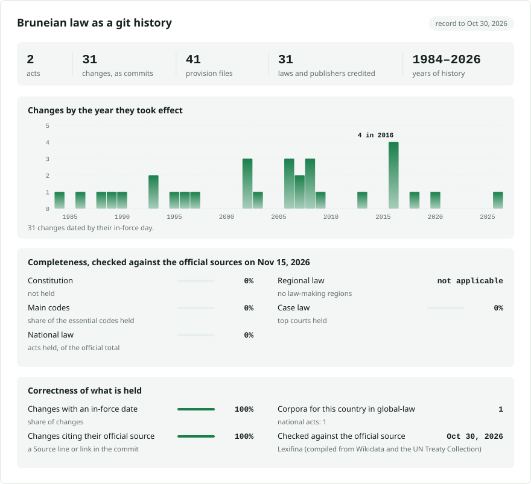

# Brunei: law history in git

<picture>
<source media="(prefers-color-scheme: dark)" srcset="data/effort-dark.svg">

</picture>

Brunei's law as a git history, on the design every country here shares: one file per unit, one commit per version on the day it took effect, and the record that made each change as the commit's author. It holds the Constitution and the text of 181 Acts, Orders and subsidiary instruments taken from secondary copies (FAOLEX, WIPO Lex, the ASEAN Inter-Parliamentary Assembly's AIPA Lync, the Asian Development Bank's Law and Policy Reform repository and the International Commission of Jurists), Brunei's actions on treaties deposited with the UN, and facts about its legal system. `git blame` names the instrument or day's treaty actions behind every line; `git log` lists every action on a treaty; picking a date gives the record as it stood that day.

Part of [lexifina/global-law](https://github.com/lexifina/global-law), one git history for every country's law: this is Brunei's national law, which global-law reads at `brunei/national/acts/`.

**What is in it now:** the Constitution and 181 laws with text, 187 dated versions from 1975 to 2025: [`constitution/`](constitution/README.md) (the Constitution as reprinted on 8 November 2008, one file per Article), [`laws/`](laws/) (73: 45 Acts of the Laws of Brunei in `cap-NNN-<name>/` folders, including the Penal Code and the Criminal Procedure Code, and 28 Orders made under Article 83(3), including the Syariah Penal Code Order, 2013 and the Employment Order, 2009), [`amending-orders/`](amending-orders/) (34) and [`subsidiary/`](subsidiary/) (74, by year), one file per instrument. [`treaties/`](treaties/README.md) records Brunei's actions on 26 multilateral treaties deposited with the UN Secretary-General: 32 actions (19 accessions, 7 signatures and 6 ratifications) on 30 days from 5 December 1984 to 30 March 2020, one version per day. [`legal-system/`](legal-system/README.md) holds 13 files of facts about the state from Wikidata, such as its head of state, its legislative body and the three legal instruments Wikidata records, in one version; they are not law. [`REPRODUCE.md`](REPRODUCE.md) says how the files were made.

**Why the law text comes from secondary copies.** The Attorney General's Chambers publishes Brunei's laws at [agc.gov.bn](https://www.agc.gov.bn), but its Terms of Use (2.2) forbid reproducing or re-using its material without the Government's express written permission, and none has been given, so nothing is taken from agc.gov.bn. The texts here are the copies that FAOLEX (FAO), WIPO Lex (WIPO), AIPA Lync (ASEAN Inter-Parliamentary Assembly), the ADB Law and Policy Reform repository and the International Commission of Jurists publish; none of those copies carries a notice requiring the Government's permission. Each commit names its copy in a `Source-status: secondary copy (...)` trailer.

Each treaty is one file named from its number in the UN Treaty Collection: `treaties/xxvii-7-d.md` is the Paris Agreement (XXVII-7-d).

The records are in English, with names as Wikidata and the UN Treaty Collection give them.

## Questions as git commands

| Question | Command |
| --- | --- |
| Every action Brunei took on the Paris Agreement | `git log -p --word-diff -- treaties/xxvii-7-d.md` |
| Which day's actions wrote each line? | `git blame treaties/xxvii-7-d.md` |
| Every version of the Paris Agreement's record, with the day of each | `git log --format="%h %(trailers:key=In-force,valueonly,separator=) %an" -- treaties/xxvii-7-d.md` |
| The record as it stood on 1 June 2016 | `python tools/on.py 2016-06-01 treaties xxvii-7-d` |

**Outside git**, we also host this record publicly, for free:

- **[Ask Claude about Brunei](https://global-law.lexifina.com/v1/try_claude?country=brunei)**: opens Claude with a first question ready.
- **[Ask ChatGPT](https://global-law.lexifina.com/v1/try_chatgpt?country=brunei)**: the same question in ChatGPT.
- **[Search Brunei's record on our site](https://lexifina.com/law?country=brunei&q=Convention)**: a search for "Convention" in its catalogue of titles, no account needed.
- **[Developer REST API](https://global-law.lexifina.com/v1/search_law?query=Convention&jurisdiction=brunei)**: the same search as JSON, with no key. See the [documentation here](https://lexifina.com/api/global-law).

Both assistants read the record through the free Global law connector (MCP, `https://global-law.lexifina.com/mcp`); the first time, the chat gives you the link that adds it. Ask in English.

**Host it yourself easily.** All it takes is git and Python, and the tools run on your machine:

```sh
git clone --depth 1 https://github.com/lexifina/global-law && cd global-law
python3 tools/countries.py add brunei/national/acts
python3 tools/law.py show 2026-01-01 brunei/national/acts/treaties/xxvii-7-d.md
```

Opened in Claude Code, Cursor, VS Code or Codex, the clone also starts a local MCP server with the same tools ([MCP.md](https://github.com/lexifina/global-law/blob/main/MCP.md)).

## Dates

Each commit is dated at noon, Asia/Brunei, and carries its day in its `In-force:` trailer:

- for a treaty, the day the UN Treaty Collection records for Brunei's action (signature, ratification or accession). It is the day of the action, not the day the treaty came into force for Brunei;
- for a law, the day it took effect: its own commencement clause, the "Commencement" line of its Revised Edition, the day printed on a Revised Edition ("REVISED EDITION 2001 (1st October 2001)"), or the entry-into-force date FAOLEX or WIPO Lex records, quoted in `In-force-basis`. An instrument with no commencement provision, or one that commences on a day appointed by a later notice the sources do not give, is dated by the Gazette that published it (`Date-basis: published`); a Revised Edition that prints no day is dated by the edition date FAOLEX records (`Date-basis: edition`). The Constitution is dated 8 November 2008, the day its reprint was authorised "incorporating therein all amendments in force at the date of this authorisation" (`Date-basis: edition`). Each says so in its `In-force-basis`. A text with no date at all is held back;
- for the Wikidata facts, which have no dated history, 30 October 2026, the day they were read, as the oldest version available. A date before that gives no facts.

Each day's treaty actions are credited to a record named for that day (`UN treaty actions of 2016-09-21`), with an e-mail address that cannot exist; the Wikidata facts to the publisher, `Lexifina (compiled from Wikidata and the UN Treaty Collection)` (`Kind: publisher`). The committer is Lexifina.

## How it is checked

- `tools/check_repo.py` reads every version back from git on the day it took effect and on the day before and compares it with the corpus, whose hash is in `data/corpus.sha256`; it also checks that every commit's trailers parse, that `main` has no merge commits and that no commit is dated in the future.
- `tools/build.py` writes the history from that one corpus file, and the same corpus gives the same commit hashes. [`REPRODUCE.md`](REPRODUCE.md) records that the checks were not yet run for this build and that no second build has been compared.
- Only facts are taken from the UN pages: each treaty file holds the treaty's name, where and when it was adopted, its depositary, Brunei's actions with their dates, and the page they came from.
- [vulnerabilities/](vulnerabilities/): possible drafting mistakes in this law, found by global-law's detectors and checked by hand. Not run yet.

## What it does not show

- **Most law text.** Only the laws the secondary sources carry are here, and of those only versions with a date; about 70 copies with no date at all (mostly Revised Editions that print only a year, among them the Companies Act and the Land Code) are held. Only one version of the Constitution (2008) is here. 137 of the 187 texts are the publisher's OCR of scanned Gazette prints and keep its misreadings.
- **Most treaty actions.** Only a fixed list of about 60 multilateral treaties deposited with the UN Secretary-General was read; bilateral treaties and treaties deposited elsewhere are not here.
- **Reservations, declarations and entry into force.** The treaty files give the dates of Brunei's actions only.
- **A dated history of the facts.** Wikidata keeps none, and it can be incomplete or wrong.

## Sources

| Source | Kind | Past versions | Notes |
| --- | --- | --- | --- |
| [United Nations Treaty Collection](https://treaties.un.org/) | Status pages of multilateral treaties deposited with the UN Secretary-General | yes, each action on its day | Facts only: treaty names and the dates of signature, ratification or accession; read on 30 October 2026 |
| [Wikidata](https://www.wikidata.org/wiki/Q921) | Facts about the state (CC0), not law | no, one reading | Read on 30 October 2026 |
| [FAOLEX](https://faolex.fao.org/) (FAO) | Secondary copies of Acts, Orders and regulations, as made and as revised | yes, where a record holds both | 108 versions; PDFs read on 26 November 2026 |
| [WIPO Lex](https://www.wipo.int/wipolex/en/members/profile/BN) (WIPO) | Secondary copies of intellectual property and related laws | yes, where a record holds both | 25 versions, including the 2008 reprint of the Constitution; PDFs read on 26 November 2026 |
| [AIPA Lync](https://aipalync.org/document?organization=national-laws&countries=brunei-darussalam) (ASEAN Inter-Parliamentary Assembly) | Secondary copies of Brunei national laws, as made and as revised | yes, where it holds both | 35 versions; PDFs read on 27 November 2026 |
| [ADB Law and Policy Reform](https://lpr.adb.org/) (Asian Development Bank) | Secondary copies of Brunei Orders and Acts | no | 12 versions; PDFs read on 27 November 2026 |
| [International Commission of Jurists](https://www.icj.org/country/brunei-darussalam/) | Secondary copies of criminal and security laws (SE Asia security law database) | no | 7 versions, including the Criminal Procedure Code and the Syariah Penal Code Order, 2013; PDFs read on 27 November 2026 |

## Licence

See [`LICENSE`](LICENSE). The Wikidata facts are CC0 1.0. From the UN Treaty Collection only facts are taken, the treaty names and the dates of treaty actions, credited to its status pages of multilateral treaties deposited with the Secretary-General. The law texts are copies published by FAOLEX (FAO, reuse for non-commercial purposes with acknowledgement) WIPO Lex (WIPO), AIPA Lync (ASEAN Inter-Parliamentary Assembly), the ADB Law and Policy Reform repository and the International Commission of Jurists; each source's terms are in the LICENSE. Lexifina's history, commit messages, tables and tools are CC0 1.0.

No AI model wrote, translated or corrected legal text; the scripts were written by an AI model, and no model runs when the history is built (see [`REPRODUCE.md`](REPRODUCE.md)).

## Visualisations

- [visualisations/](visualisations/): charts drawn from this repository. Not drawn yet.

## More

From [lexifina/global-law](https://github.com/lexifina/global-law):

- [FEATURES.md](https://github.com/lexifina/global-law/blob/main/FEATURES.md): every feature, and what every corpus must support (`git blame`, `law.py`, the MCP tools)
- [FAQ.md](https://github.com/lexifina/global-law/blob/main/FAQ.md): questions and answers · [CONTRIBUTING.md](https://github.com/lexifina/global-law/blob/main/CONTRIBUTING.md): proposing changes · [MCP.md](https://github.com/lexifina/global-law/blob/main/MCP.md): the MCP server · [REPRODUCE.md](https://github.com/lexifina/global-law/blob/main/REPRODUCE.md): how it was built · [CHANGELOG.md](https://github.com/lexifina/global-law/blob/main/CHANGELOG.md)
- [FRESHNESS.md](https://github.com/lexifina/global-law/blob/main/FRESHNESS.md): how current each corpus is · [Monitoring](https://github.com/lexifina/global-law/tree/main/monitoring): whether updates are running · [WATCHING.md](https://github.com/lexifina/global-law/blob/main/WATCHING.md): how each official source is watched for changes
- [performance/](https://github.com/lexifina/global-law/tree/main/performance): how fast the tools are, measured
- [visualisations/](https://github.com/lexifina/global-law/tree/main/visualisations): charts and bridges across the world's law
- [Vulnerabilities](https://github.com/lexifina/global-law/tree/main/vulnerabilities): mistakes in legislation as published
